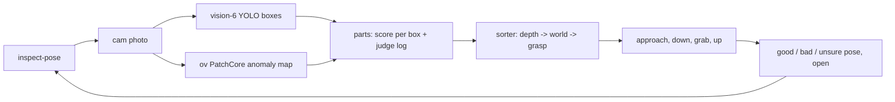

# Handoff — Day 2 morning (Track 3 "Spot it, sort it", armfarm01)

Written 2026-11-14, night of Day 1. Judging: **Day 2, 3:30 PM**. Full background and history: `~/codes/personal/robot-sort-plan.md`.

## Contents

1. [Where things stand](#1-where-things-stand)
2. [First things at the station](#2-first-things-at-the-station)
3. [Station check sequence](#3-station-check-sequence)
4. [Commands](#4-commands)
5. [Settings to tune](#5-settings-to-tune)
6. [Risks and known gaps](#6-risks-and-known-gaps)
7. [Code map](#7-code-map)
8. [IDs and locations](#8-ids-and-locations)

---

## 1. Where things stand

| Piece | State | Evidence |
|-|-|-|
| YOLO part detector `vision-6` (NPU) | Deployed, works | On NUC: 27/27 test parts found, 0 false boxes |
| PatchCore `ov` / `vision-1` (GPU f32, team's `sortit-patchcore` v1) | Deployed, works | AUROC 0.955 on photos taken after its training |
| Our module `robot-sort` on the NUC | Running | Log: `Modules successfully added`, both services constructed |
| Service `parts` (`robotsort:vision:parts`) | Live; answers `objects` in 192–240 ms | Found 0 parts: room lights were off |
| Service `sorter` (`robotsort:generic:sorter`) | Live, **`dry_run: true`** | `status` OK; `sort_one` refused as designed |
| Camera → world math | Verified against live `TransformPose` (< 1e-6 mm) | `tests/test_geometry.py` |
| Real pick | **Never run** | Arm e-stop was pushed in; nobody at station |
| Tests | 13 pass on the Mac | `tests/` |

## 2. First things at the station

- [ ] Release the arm **emergency stop** (it was pushed in: "xArm: Emergency Stop Button Pushed In").
- [ ] Turn the lights on. Both cameras gave black frames at night.
- [ ] Check the machine is online: `viam machines part status --part=f08ae88f-5fa8-4775-a3bf-0f4fda96940f`.
- [ ] Check the module is up: `viam machines part logs --part=f08ae88f-5fa8-4775-a3bf-0f4fda96940f --count=200 | grep -i robot-sort`.

## 3. Station check sequence

Do these in order. Keep a hand on the e-stop from step 3 onwards.

- [ ] **1. Vision.** Put one plain bolt on the cardboard. Call `parts` `objects`. Expect one object, label `normal`, score well below 0.3. Repeat with a defective item (blue paint, foam); expect `anomalous`, score above 0.5.
- [ ] **2. Plan (arm moves to inspect-pose only).** Call `sorter` `plan`. Check the result:
  - [ ] `grasp.surface_z` ≈ 11 mm (cardboard height measured at night).
  - [ ] `grasp.x`, `grasp.y` match the bolt's real position from the arm base (ruler). Error should be a few mm.
  - [ ] `grasp.z_top` − `surface_z` ≈ bolt height.
- [ ] **3. First pick.** Set `dry_run` false (section 4). Call `sorter` `sort_one` on the bolt. Watch:
  - [ ] Approach height safe (80 mm above part top).
  - [ ] Fingers go low enough: if they close above the bolt, raise `grasp_depth_mm`; if they hit the cardboard, lower it.
  - [ ] Fingers close **across** the bolt: if along it, set `yaw_offset_deg` to 90 (or whatever angle fixes it).
  - [ ] Arm reaches the bin pose and the item drops in.
- [ ] **4. Each item type.** Bolt, nut, washer, foam, block. Fix settings as needed.
- [ ] **5. Thresholds.** Take 10–20 photos (good, bad, dark bolt, touching items, an object never seen). Read scores from `objects`; adjust `box_lo` / `reject_hi` on `parts`. Decide PatchCore v1 vs v2 here.
- [ ] **6. Rehearsal.** 6 items, `start` with `max_items` 6, judge moves one mid-run. Check `log` output and latency values.
- [ ] **7. Before judging.** Send `parts` `new_run` (plan and test cycles write to the log).

## 4. Commands

Part ID: `P=f08ae88f-5fa8-4775-a3bf-0f4fda96940f`. All calls work from the Mac.

| Action | Command |
|-|-|
| Vision now (no logging) | `viam machines part run --part=$P --method=viam.service.vision.v1.VisionService.DoCommand --data='{"name":"parts","command":{"command":"objects"}}'` |
| Plan one item | `viam machines part run --part=$P --method=viam.service.generic.v1.GenericService.DoCommand --data='{"name":"sorter","command":{"command":"plan"}}'` |
| Sort one item | same, with `{"command":"sort_one"}` |
| Background run | same, with `{"command":"start","max_items":6}` |
| Stop | same, with `{"command":"stop"}` (also stops the arm) |
| Status | same, with `{"command":"status"}` |
| Judge log | `parts` DoCommand `{"command":"log"}`; file on NUC under the module data dir, `items-<run>.csv` |
| Fresh log | `parts` DoCommand `{"command":"new_run"}` |
| Allow motion | `viam resource update --part=$P --resource-name=sorter --config='{"parts_name":"parts","dry_run":false}'` (include every attribute you want kept) |
| Change a setting | e.g. `--config='{"parts_name":"parts","dry_run":false,"yaw_offset_deg":90,"grasp_depth_mm":8}'` |
| Change thresholds | `viam resource update --part=$P --resource-name=parts --config='{"detector_name":"vision-6","mlmodel_name":"ov","camera_name":"cam","box_lo":0.3,"reject_hi":0.5}'` |
| Deploy code changes | From `~/codes/personal/robot-sort`: stage the 7 module files (`main.py scoring.py geometry.py picker.py item_log.py run.sh requirements.txt`) in a folder named `robot_sort_module`, then `viam machines part cp --part=$P -r -p robot_sort_module machine:/root/`, then `viam machines part restart --part=$P` |
| Run tests | `cd ~/codes/personal/robot-sort && uv run --python 3.12 --with-requirements requirements.txt --with pytest pytest -q tests` |

> [!WARNING]
> `plan` moves the arm to inspect-pose. `sort_one` and `start` move the arm fully. Have someone at the e-stop.

## 5. Settings to tune

| Service | Setting | Now | What it does |
|-|-|-|-|
| `parts` | `min_confidence` | 0.5 | YOLO boxes below this are ignored |
| `parts` | `box_lo` / `reject_hi` | 0.3 / 0.5 | Part score below `box_lo` → box; above `reject_hi` → reject; between → hold |
| `sorter` | `dry_run` | true | Blocks `sort_one` / `start` |
| `sorter` | `approach_mm` | 80 | Height above the part top for approach and lift |
| `sorter` | `grasp_depth_mm` | 5 | How far below the part top the gripper frame goes (**guess**) |
| `sorter` | `floor_clearance_mm` | 3 | Never closer than this to the cardboard |
| `sorter` | `yaw_offset_deg` | 0 | Finger direction correction (**guess**) |
| `sorter` | pose names | `inspect-pose`, `good-pose`, `bad-pose`, `unsure-pose` | Team's saved switches; `SetPosition(2)` moves there |

## 6. Risks and known gaps

| Item | Status | What to do |
|-|-|-|
| Camera mount accuracy (fragment) | Math verified, mount not | Step 2 ruler check |
| `grasp_depth_mm`, `yaw_offset_deg` | Guesses | Step 3 |
| Motion planning with gripper pointing down | Never run on this arm | Step 3, hand on e-stop |
| Gripper frame point (z 105 from flange) may not be the fingertips | Unknown | Tune `grasp_depth_mm` |
| Moved logged item | Logged again as new item; old line has no arm time | Accept; explain in the talk |
| PatchCore v1 vs v2 | Undecided | Step 5 |
| YOLO on touching items / unseen object | Untested live | Step 5 |
| Type checker | 8 + 14 loose config-type warnings (same kind as the team's module) | Ignore; tests pass |
| `overview-cam` | Stationary side-view webcam, no depth, **not calibrated** (placeholder frame) | Optional later: placement check, talk photos, recovery watch |
| `robot-sort` has no git | No history | Consider `git init` before editing at the station |

## 7. Code map

All in `~/codes/personal/robot-sort/`.

| File | What it does |
|-|-|
| `main.py` | `parts` service. `_analyze` runs YOLO and PatchCore at the same time on one photo and scores each box. DoCommands `objects`, `decide`, `next`, `arm_start`, `log`, `new_run` |
| `scoring.py` | `score_parts`: drops low-confidence boxes, clips to the photo; team's `label_objects` (90th-percentile heat on part pixels minus surface median) |
| `item_log.py` | Team's judge log, unchanged: number, decision, confidence, timestamps, latency |
| `geometry.py` | Depth decode, pinhole deproject, Viam orientation vector → rotation (with rdk's near-pole rule), `plan_grasp` |
| `picker.py` | `sorter` service: `_cycle` (inspect → decide → target → grasp → move → place), background `start`/`stop` |
| `run.sh` | Builds `.venv` with `uv` on first start, then runs `main.py` |
| `tests/` | 13 tests (scoring, wiring with fakes, geometry vs live station points, picker order) |

## 8. IDs and locations

| What | Value |
|-|-|
| Machine armfarm01 / main part | `f98e9633-107d-4ece-b19f-b8ab78ec95ef` / `f08ae88f-5fa8-4775-a3bf-0f4fda96940f` |
| Org hackathons | `6d6c7293-bc67-43e4-9c8b-31c76aac27d3` |
| Module on NUC | `/root/robot_sort_module/run.sh` (local module `robot-sort`) |
| Team's module (untouched) | `/root/viam_module` (`sortit:vision:objects`, service `objects`) |
| YOLO files on NUC | `/root/yolov8n-part/`; registry backup `sortit-armfarm01-yolo-part` v1 |
| Our dataset | `sortit-armfarm01-part-boxes-v1`, id `6af7e938aaa10113c352a8f0` |
| Config change script and before/after JSON | `/private/tmp/claude-501/-Users-satyamchatrola-codes-personal/9a8d4125-48f8-4fd4-9f74-855706bfd1b4/scratchpad/scripts/` (temporary; lost on reboot) |
| Plan | `~/codes/personal/robot-sort-plan.md` |
